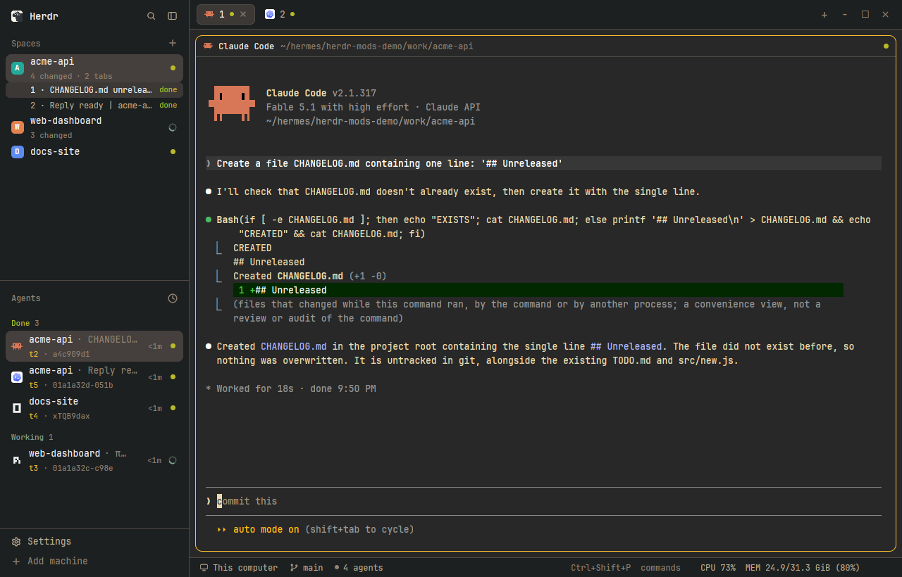
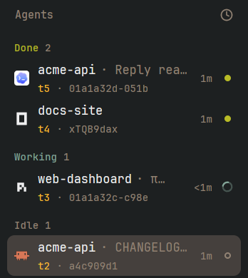
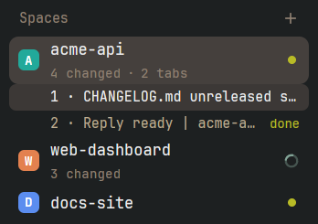

# herdr-mods

Three mods for the [Herdr desktop app](https://herdr.dev) (herdr-app) that put more of what you need
into the sidebar: which session each coding agent is running, what changed in each space, and how
busy the machine is.



| Mod | What it adds |
|---|---|
| [**agents-ids**](mods/agents-ids/RECIPE.md) | A second line under every agent: terminal address and short session ID. Click to copy. Works with Claude Code, Codex, Pi, PiG and OpenCode, and any agent that sets one label. |
| [**spaces-plus**](mods/spaces-plus/RECIPE.md) | Git changes, tab count and agent status per space, the active space's tabs, recent spaces to reopen. |
| [**sysstat**](mods/sysstat/RECIPE.md) | CPU and memory in the status bar (Linux). |

<p>
  
  
</p>

## Install

```sh
git clone https://github.com/DarkoKuzmanovic/herdr-mods ~/code/herdr-mods
cd ~/code/herdr-mods
./install.sh               # mods + session-ID hooks for the agents you have
./install.sh --mods-only   # just the mods
herdr-app do layout.switch '{"name":"main-plus"}'
```

`install.sh` copies the mods into `~/.config/herdr-app/mods/` and adds a `main-plus` layout: Herdr's
`main` with the three mods in place. `Ctrl+Shift+L` switches back to your own layout. Re-run it after
`git pull`; it updates in place, adds each hook once, and moves anything of yours that's in the way to
`~/.cache/herdr-mods/backup-<time>/` instead of overwriting it.

Prefer your own layout? Clone it and set `content.mod` of the `spaces` and `agents` blocks to
`spaces-plus` and `agents-ids`; add a `sysstat` block where you want the bar (it docks at the bottom by
itself the first time Herdr sees it).

Asking an agent instead? Point it at a mod's folder on GitHub; herdr-app's own `AGENTS.md` tells it how
to add a shared mod, and each `RECIPE.md` is the brief to rebuild one from scratch.

## Session IDs: how agents report them

`agents-ids` reads one terminal label, `agent.session`. Anything running in a herdr-app terminal can set
it:

```sh
hc label "$HC_TERMINAL_ID" agent.session=<session-id>
```

`integrations/` does this for you (`./install.sh` sets up the ones whose config folder exists):

| Agent | Hook | ID shows up |
|---|---|---|
| Claude Code | `SessionStart` hook in `~/.claude/settings.json` | at start |
| Codex | `SessionStart` hook in `~/.codex/hooks.json` (needs `hooks = true` under `[features]`) | after the first prompt |
| Pi, PiG | extension `agent-session.ts` in `~/.pi/agent/extensions/`, `~/.pig/agent/extensions/` | at start |
| OpenCode | TUI plugin `agent-session-label/`, listed under `plugins` in `~/.config/opencode/cli.json` | after the first prompt |
| Anything else | call `agent-session-label <id>` from its session-start hook | |

All of them call [`integrations/bin/agent-session-label`](integrations/bin/agent-session-label), linked
into `~/.local/bin`. It labels only when the agent is the terminal's foreground program, so an agent
that another agent starts in the background (`claude -p` from a script) can't overwrite the ID you see.
Outside herdr-app it does nothing, and it never makes a hook fail. It reads `/proc`, so Linux only for now.

To remove a hook, delete its line or file from the places above.

## Develop

```sh
./install.sh --watch    # copy mods into herdr-app, then re-copy on every save
node mods/agents-ids/test_logic.mjs && node mods/spaces-plus/test_logic.mjs && python3 -I tests/test_label.py
herdr-app check ~/.config/herdr-app/mods/agents-ids
```

Edit in this checkout, not in `~/.config/herdr-app/mods/`: `--watch` overwrites the copies there. The
mods are copied rather than symlinked because herdr-app hot-reloads a mod only when a file in its own
folder changes, and an edit behind a symlink never reaches that folder.

`agents-ids` and `spaces-plus` are copies of Herdr's shipped `agents` and `spaces`. The `upstream`
branch holds those shipped files unchanged, at the same paths. When a herdr-app update changes them:

```sh
git switch upstream
cp ~/.config/herdr-app/mods/agents/main.js mods/agents-ids/main.js
cp ~/.config/herdr-app/mods/spaces/main.js mods/spaces-plus/main.js
git commit -am "Herdr's agents and spaces from herdr-app <version>"
git switch main && git merge upstream   # conflicts show exactly where Herdr and these mods both changed
```

## Requirements

herdr-app 0.1.12 or later, `git`, `rsync`, `python3`. Session-ID hooks and `sysstat` need Linux.
