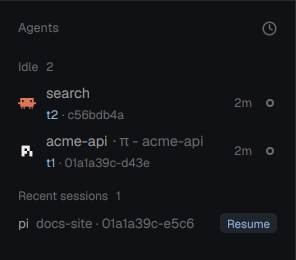

# Agents with IDs

Herdr's Agents list, with a second line under every agent: the terminal's address (`t3`) and the
agent's short session ID (`01a1a32c-c98e`). Click the line to copy the session ID; Shift-click to copy
the address. Handy for `claude --resume`, `pi --session`, `codex resume`, `hc read t3` and for telling
two agents in the same folder apart. Below the agents, **Recent sessions** lists the agent sessions that
ended, each with a **Resume** button that reopens it.

**What you see:** the shipped `agents` mod unchanged (groups by status, sort menu, pins, sub-agents),
except each row is 44px tall instead of 30px and has two lines:

1. The agent icon, the space name, `· <tab title>` in the dim color, the age and the status mark, as in
   the shipped mod.
2. 11px text: the terminal address in the theme `accent` color, then `· <short session id>` in `dim`.
   Without a session ID only the address shows.

3. **Recent sessions**, a foldable group after the others (header like the others, `Recent sessions n`):
   28px rows of the program name (`muted`), `<folder> · <short id>` (`dim`) and a `Resume` pill (10.5px
   semibold, `accent` text on a 12% tint of it). Up to 5, newest first.

Short IDs: Hermes drops its `local-` prefix and shows 8 characters; UUIDv7 IDs (Pi, PiG, Codex) show 13
(their first 8 repeat for about a minute); OpenCode `ses_…` IDs show their last 8 (the random part);
anything else shows its first 8.

**How it behaves:** statuses (working, blocked, done, idle) look and sort exactly as in `agents`.
Hovering the second line shows the full address and session ID. Click copies the session ID (or the
address when there is none); Shift-click copies the address. The click doesn't select the row.
A session is *recent* when its terminal no longer runs it: the agent quit (the terminal is back at a
shell or runs something else) or the terminal closed. The mod remembers each labelled session it sees
(where, when) in `localStorage`, up to 20 for 14 days, so closed terminals and restarts don't lose
them; one that runs again anywhere leaves the list. **Resume** at a bare shell types the command into
that terminal; otherwise it opens a new tab in the session's space and folder with the command as its
argv. Commands: `claude --resume`, `codex resume`, `pi --session`, `pig --session`, `opencode --session`,
`hermes --resume`. Clicking the row copies the session ID.

**Built from:** a copy of the shipped `agents` mod (herdr-app 0.1.12). Its own logic is in
`extras.mjs` (pure: `shortSid`, `resumeArgv`, `rememberSessions`, `recentSessions`). In `main.js`: a map
from terminal address to `labels["agent.session"]` from `terminals()`; the second line in the row
render; `recentRow()` and `resume()` (`hc(["send", …])` or `run("tab.new", { space, folder, argv })`);
the sort popup opens `{ mod: "agents-ids" }`. The session ID comes from a terminal
label any program can set: `hc label $HC_TERMINAL_ID agent.session=<id>`. `agent.app` names the program for Resume. This repo's
`integrations/` sets both for Claude Code, Codex, Pi, PiG, OpenCode and Hermes; any other agent can
call the same script from its session-start hook.

**Watch out:**
- Herdr's `AgentInfo` has no session ID; the label is the only way in. Agents that set no label show
  just their address.
- An agent started by another agent (one agent running `claude -p`) must not overwrite the visible
  agent's label; `agent-session-label` only labels when the agent is the terminal's foreground job.
- Codex and OpenCode report their session after the first prompt, so a fresh one shows only its address.
- `terminals()` lists live terminals only; a closed terminal's session survives only because the mod
  remembered it.
- Agents save a session only once it has a message: Resume on one quit before its first prompt gets
  the agent's own "no session found".
- Labels are written by any program: Resume runs only IDs of letters, digits, `-`, `_`, `.`, and types
  only into a bare shell (never into an editor or another program in front).
- The mod is a copy: when Herdr ships a new `agents`, merge it (see the repo's README).

**Done when:**
- `herdr-app check mods/agents-ids` passes and `node mods/agents-ids/test_logic.mjs` prints `ok`.
- `hc label <t> agent.session=test-1234567890` makes `<t> · test-123` appear under that agent within a
  second; clicking it puts `test-1234567890` on the clipboard.
- Quitting a labelled Claude Code moves it to Recent sessions; Resume there brings back the same
  conversation in that terminal.
