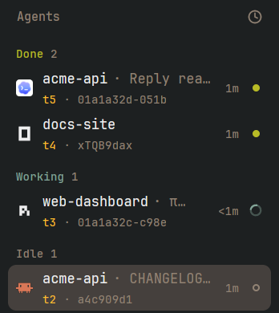

# Agents with IDs

Herdr's Agents list, with a second line under every agent: the terminal's address (`t3`) and the
agent's short session ID (`01a1a32c-c98e`). Click the line to copy the session ID; Shift-click to copy
the address. Handy for `claude --resume`, `pi --session`, `codex resume`, `hc read t3` and for telling
two agents in the same folder apart.

**What you see:** the shipped `agents` mod unchanged (groups by status, sort menu, pins, sub-agents),
except each row is 44px tall instead of 30px and has two lines:

1. The agent icon, the space name, `· <tab title>` in the dim color, the age and the status mark, as in
   the shipped mod.
2. 11px text: the terminal address in the theme `accent` color, then `· <short session id>` in `dim`.
   Without a session ID only the address shows.

Short IDs: Hermes drops its `local-` prefix and shows 8 characters; UUIDv7 IDs (Pi, PiG, Codex) show 13
(their first 8 repeat for about a minute); OpenCode `ses_…` IDs show their last 8 (the random part);
anything else shows its first 8.

**How it behaves:** statuses (working, blocked, done, idle) look and sort exactly as in `agents`.
Hovering the second line shows the full address and session ID. Click copies the session ID (or the
address when there is none); Shift-click copies the address. The click doesn't select the row.

**Built from:** a copy of the shipped `agents` mod (herdr-app 0.1.12). Additions: `shortSid()`; in
`refresh`, a map from terminal address to `labels["agent.session"]` from `terminals()`; the second line
in the row render; the sort popup opens `{ mod: "agents-ids" }`. The session ID comes from a terminal
label any program can set: `hc label $HC_TERMINAL_ID agent.session=<id>`. This repo's `integrations/`
sets it for Claude Code, Codex, Pi, PiG and OpenCode; any other agent can call the same script from its
session-start hook.

**Watch out:**
- Herdr's `AgentInfo` has no session ID; the label is the only way in. Agents that set no label show
  just their address.
- An agent started by another agent (one agent running `claude -p`) must not overwrite the visible
  agent's label; `agent-session-label` only labels when the agent is the terminal's foreground job.
- Codex and OpenCode report their session after the first prompt, so a fresh one shows only its address.
- The mod is a copy: when Herdr ships a new `agents`, merge it (see the repo's README).

**Done when:**
- `herdr-app check mods/agents-ids` passes and `node mods/agents-ids/test_logic.mjs` prints `ok`.
- `hc label <t> agent.session=test-1234567890` makes `<t> · test-123` appear under that agent within a
  second; clicking it puts `test-1234567890` on the clipboard.
