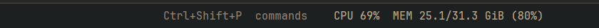

# CPU and memory

A slim status bar showing this computer's CPU load and memory use, updated every 2 seconds:
`CPU 69%  MEM 25.1/31.3 GiB (80%)`.

**What you see:** a 28px bar, theme `chrome` background with a 1px `border` line on top, 14px side
padding, 11.8px text in `muted`. Before the first reading it shows `CPU —  MEM —`; if the numbers can't
be read, `CPU / MEM unavailable`.

**How it behaves:** reads `/proc/stat` and `/proc/meminfo` every 2000ms. CPU is the busy share since the
last reading (so the first reading shows `—`); memory is `MemTotal − MemAvailable`. It redraws only
when the text changes. No clicks.

**Built from:** one `View` (`h_flex`), `readTextFile` and `theme()` from `herdr`, `cx.timer.every`.
`mod.json` docks it at the bottom (`"place": "bottom", "size": 28`); the repo's `main-plus` layout puts
it at the right of the status row instead.

**Watch out:** Linux only (`/proc`). It shows the machine the app runs on, not a remote space's machine.

**Done when:** `herdr-app check mods/sysstat` passes and the bar shows a CPU percentage within 4 seconds
that rises under load (`yes > /dev/null`).
